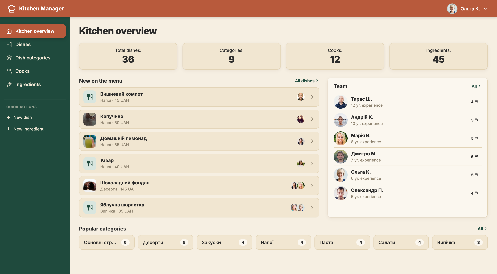
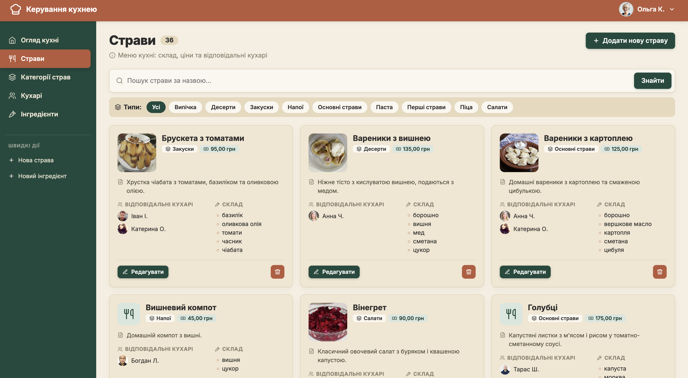
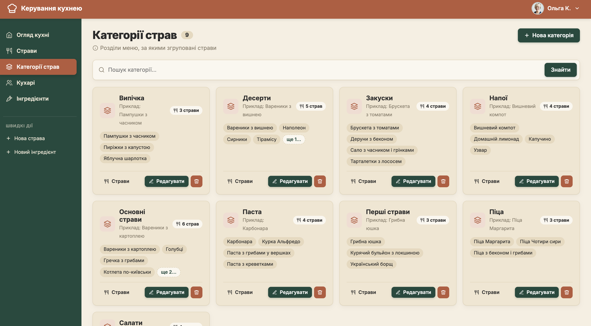
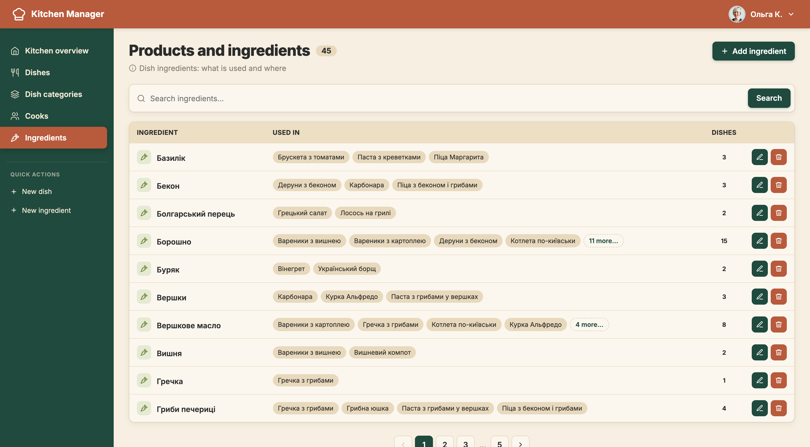

# Restaurant Kitchen Service

A Django web app for managing a restaurant kitchen. You can keep a menu of dishes with prices, descriptions and photos, group dishes into categories, maintain a list of ingredients and see which dishes use them, and manage the team of cooks by assigning who is responsible for each dish. It has search, category filtering, pagination and a kitchen overview page with statistics; only registered cooks can access the site.

## Test user

You can log in with a test account:

- **Username:** `test_cook`
- **Password:** `kitchen-demo-2026`

## Getting started

```
python -m venv venv
source venv/bin/activate
pip install -r requirements.txt
cp .env.example .env
python manage.py migrate
python manage.py createsuperuser
python manage.py runserver
```

Set your own `SECRET_KEY` in `.env`.

## Screenshots

### Kitchen overview


### Dishes


### Dish categories


### Cooks


### Ingredients

