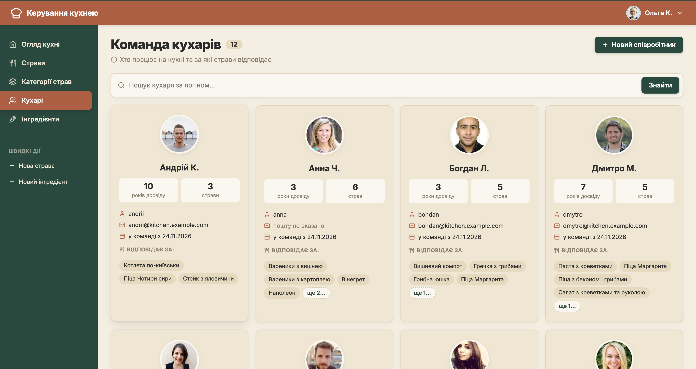

# Restaurant Kitchen Service

Веб-застосунок на Django для керування кухнею ресторану. У ньому можна вести меню страв із цінами, описами та фото, групувати страви за категоріями, зберігати список інгредієнтів і бачити, у яких стравах вони використовуються, а також керувати командою кухарів і призначати відповідальних за кожну страву. Є пошук, фільтрація за категоріями, пагінація та сторінка огляду кухні зі статистикою; доступ до сайту мають лише зареєстровані кухарі.

## Скріншоти

### Огляд кухні

### Страви

### Категорії страв

### Кухарі

### Інгредієнти

